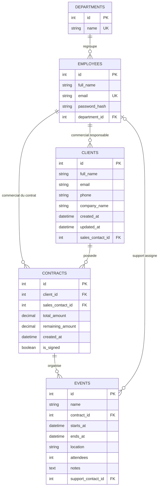

# Diagramme relationnel — Epic Events (J2)

## Choix de modélisation
- Un client est rattaché à un commercial ; un contrat conserve aussi une référence explicite à son commercial.
- Un contrat peut avoir plusieurs événements ; chaque événement référence exactement un contrat.
- Le support d'un événement est facultatif, notamment avant l'affectation par la gestion.
- Les montants sont des `Decimal` en base (`Numeric`) plutôt que des flottants.
- Des contraintes SQL empêchent les montants négatifs, les paiements restants supérieurs au total, les dates d'événement inversées et les participants négatifs.
- La cohérence métier (un commercial appartient au bon département, le commercial du contrat correspond à celui du client, signature préalable) sera contrôlée par les services métier aux jalons J3–J6.
